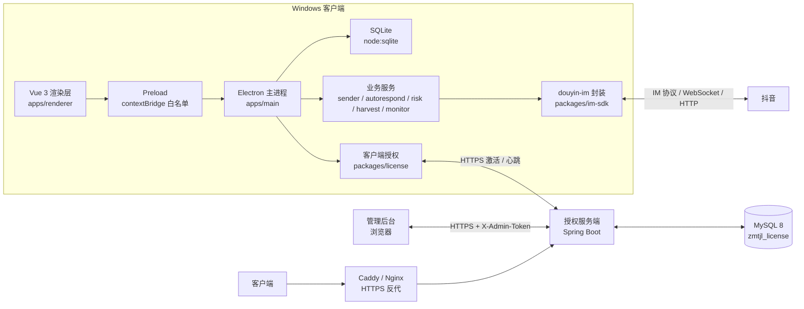
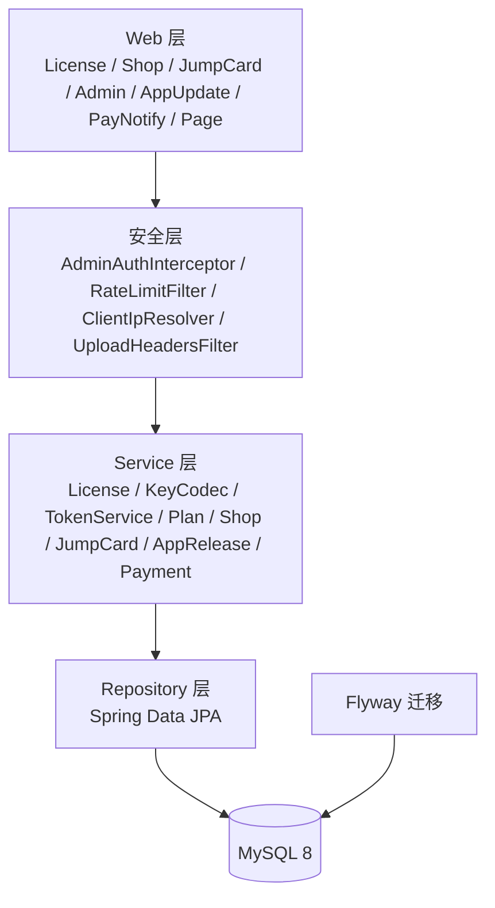
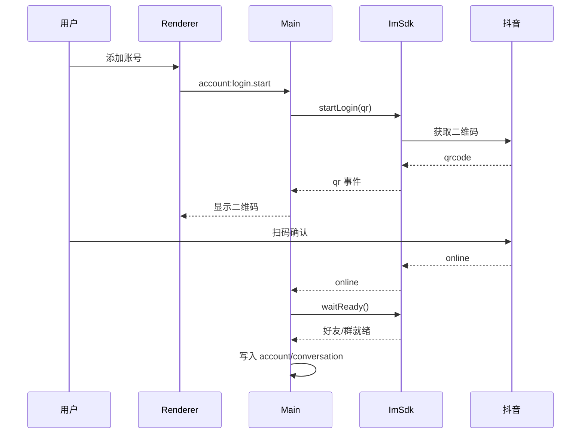
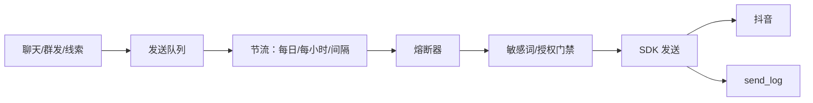
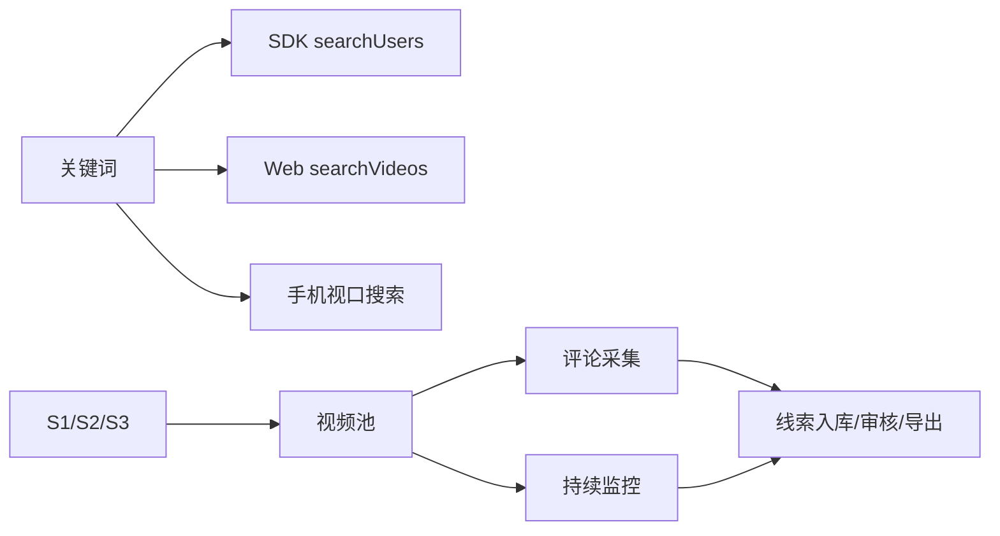
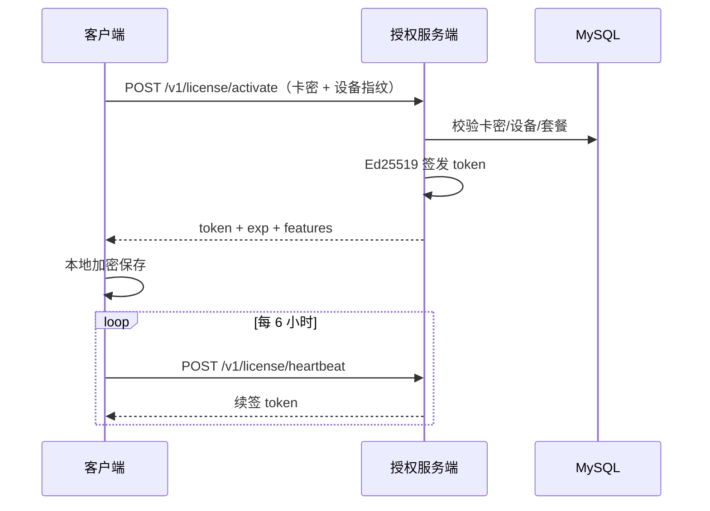
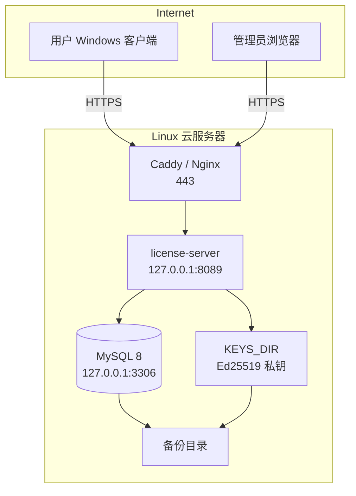

# 架构说明

> 这份文档说明「闪拓」客户端、协议 SDK、授权服务端和 MySQL 之间的关系。
> 所有域名、IP、密钥均为占位符，不代表真实环境。

---

## 1. 总体架构

### 关键边界

- **客户端只连抖音和授权服务端**，不把账号 Cookie/Session 上传到服务端。
- **授权服务端只存卡密、设备、订单、跳转卡、版本清单**，不存抖音账号会话。
- **MySQL 只在服务端内网访问**，不暴露公网。
- **管理后台通过 HTTPS 反代访问**，不直接暴露 8089。

---

## 2. 客户端

### 2.1 进程与安全边界

| 层 | 目录 | 职责 | 安全边界 |
|---|---|---|---|
| 渲染层 | `apps/renderer` | Vue 3 + Element Plus 界面 | 无 Node 权限，不能直接读文件/发请求 |
| Preload | `apps/preload` | `contextBridge` 白名单 | 只暴露受控 API |
| 主进程 | `apps/main` | 窗口、IPC、数据库、业务编排 | 有 Node 权限，但只处理本地数据 |
| 协议层 | `packages/im-sdk` | `douyin-im` 封装、多账号、事件 | 每个账号独立 dataDir |
| 业务包 | `packages/*` | 发送、自动回复、风控、代理、授权 | 不直接操作 UI |

### 2.2 模块职责

| 模块 | 作用 |
|---|---|
| `apps/main/src/db.js` | SQLite 初始化、迁移、WAL |
| `account-repo.js` | 账号元数据（uid、昵称、状态、代理） |
| `conversation-repo.js` | 会话、未读、置顶、免打扰 |
| `apps/main/src/sender` | 发送队列、节流、熔断、配额 |
| `packages/autorespond/engine.js` | 自动回复规则匹配与决策 |
| `packages/risk/sensitive-engine.js` | 敏感词/正则检测 |
| `packages/risk/rewrite-engine.js` | 合规改写建议 |
| `packages/net/proxy-dispatcher.js` | 按账号 HTTP/WS 代理，绑代理后 fail-closed |
| `harvest-service.js` | Web 搜索/评论接口（走 SDK 内部请求通道） |
| `intercept-service.js` | 关键词截流任务、视频/评论/线索 |
| `monitor-service.js` | 持续监控、轮次、去重、增量线索 |
| `competitor-service.js` | 同行/视频库、扫描任务、断点续采 |
| `license-gate.js` | 授权状态门禁 |
| `update-service.js` | 客户端版本清单/更新下载 |
| `backup-service.js` | 本地数据库、session、卡片、聊天媒体备份 |

### 2.3 账号隔离与 SDK 生命周期

- 每个账号一个 `ImSdk` 实例、一个独立 `dataDir`。
- `AccountManager` 负责创建/恢复/迁移实例；登录临时实例成功后迁到正式 uid 目录。
- 登录后不能立刻调接口：SDK 会并行加载好友/群/陌生人，必须等 `waitReady`（最多 25 秒或好友列表非空）。
- 代理绑定后，HTTP 和 WS 都走 per-account agent；代理未就绪时 **阻断直连**，不回退真实 IP。
- 账号 session、设备指纹只存在本地 `dataDir`，不写入服务端。

### 2.4 本地数据

SQLite 主要表：

| 表 | 作用 |
|---|---|
| `account` | 账号、状态、代理、能力位 |
| `conversation` | 会话、未读、置顶、免打扰 |
| `message` / `send_log` | 消息与发送记录 |
| `outreach_task` / `outreach_item` | 线索任务与线索 |
| `competitor` / `competitor_video` | 同行与视频库 |
| `monitor` | 持续监控状态 |
| `reply_rule` | 自动回复规则 |
| `card` | 跳转卡/作品卡/名片卡 |
| `setting` | 配置 |

数据目录由 Electron `userData` 决定；生产包通常是 `%APPDATA%/Shantuo`，开发模式通常是
`%APPDATA%/Electron`。可用 `APP_USER_DATA` 覆盖。

---

## 3. 服务端

### 3.1 分层

### 3.2 模块职责

| 模块 | 作用 |
|---|---|
| `LicenseController` | `/v1/health`、公钥、激活、心跳、解绑 |
| `ShopController` | 商品、渠道、下单、订单查询 |
| `JumpCardController` | 跳转卡查询、`/r/{code}` 短链 |
| `AdminController` | 卡密生成/查询/作废/延期/导出、激活记录、事件 |
| `AdminShopController` | 商品、订单、手动标记已付/取消/退款 |
| `AdminPlanController` | 套餐 |
| `AdminJumpCardController` | 跳转卡 CRUD |
| `AdminAppReleaseController` | 客户端版本上传/发布/下架 |
| `AppUpdateController` | 客户端版本清单/下载 |
| `PayNotifyController` | 支付回调、mock 收银台 |
| `AdminAuthInterceptor` | 校验 `X-Admin-Token` |
| `RateLimitFilter` | 按 IP/接口限流 |
| `ClientIpResolver` | 反代下的真实 IP |
| `TokenService` | Ed25519 签发/验签 |
| `KeyCodec` | 卡密 HMAC/编码 |
| `OrderCrypto` | 订单卡密 AES 加密 |
| `StartupValidator` | 生产配置校验（PUBLIC_BASE_URL/HTTPS/更新清单） |

### 3.3 数据表

| 表 | 作用 |
|---|---|
| `license_key` | 卡密、套餐、有效期、状态 |
| `activation` | 设备激活、解绑、到期 |
| `device` | 设备指纹、最后在线 |
| `event_log` | 激活/心跳/管理操作事件 |
| `plan` | 套餐 |
| `product` | 商城商品 |
| `shop_order` | 订单、支付状态、交付卡密 |
| `payment_event` | 支付回调事件 |
| `jump_card` | 跳转卡、短链、微信二维码 |
| `jump_click` | 短链点击、去重、IP HMAC |
| `app_release` | 客户端版本、SHA-256、下载地址 |

Flyway 迁移在 `server/src/main/resources/db/migration`，启动时自动执行。

---

## 4. 核心流程

### 4.1 账号登录

### 4.2 消息接收与展示

1. SDK 收到 `message` 事件 → `ImSdk` 归一化 → `AccountManager` 回调。
2. 主进程写入 `message`、更新 `conversation` 未读/预览。
3. IPC 推送到渲染层，聊天页按会话增量渲染。
4. 富消息类型（图片/视频/表情/链接卡/作品卡/名片/文件）由 `rich-reply.js` 和渲染组件解析。

### 4.3 发送

- 全局保守默认：每账号每日 20 条、每小时 5 条、间隔 8–30 秒。
- 线索雷达更保守：每日 10 条、每小时 3 条、间隔 60–180 秒。
- 连续失败熔断 30 分钟；风控信号（如 9300）立即熔断。
- `DRY_RUN=1` 只走调度/风控，不真实发送。

### 4.4 自动回复

1. 入站消息 → 规则匹配（账号/会话类型/关键词/正则/优先级）。
2. 命中后检查冷却、转人工暂停、授权。
3. 生成回复内容（文本/表情/卡片/多消息组合）。
4. 经敏感词检测/合规改写 → 发送队列 → SDK。

### 4.5 线索采集与监控

- 搜索/评论走 SDK 已登录会话的 `requestRaw`，带 cookie jar。
- 金融/汽车等敏感词可能需要手机视口签名搜索。
- 监控只在应用运行时运行；评论接口没有时间游标，靠重复扫首页 + 去重。
- 同行采集支持断点续采；视频库不设 300 条上限。

### 4.6 授权

- 客户端开发模式默认不强制；`LICENSE_ENFORCE=1` 或打包后强制。
- 断网宽限 72 小时；之后只读。
- 服务端首次启动自动生成 Ed25519 密钥对；私钥必须备份。
- 设备换机需要解绑；管理后台可作废/延期卡密。

### 4.7 卡密、商城、跳转卡

- **手动开卡**：管理后台生成卡密 → 发给用户 → 客户端激活。
- **商城**：商品/套餐/订单 → 支付回调或手动标记已付 → 交付卡密。
- **跳转卡**：生成短链 `/r/{code}` → 记录点击（IP HMAC、去重）→ 跳转目标。
- **支付渠道**：默认 `manual`；mock 渠道仅测试，生产关闭。

### 4.8 客户端更新

- 管理后台上传安装包 → 填写版本/SHA-256 → 发布。
- 客户端 `update-service` 拉取 `/v1/app/version`，比较版本，下载/校验。
- 强制更新由 `update-min-version` 控制。

---

## 5. 部署拓扑

- 客户端在 Windows 上运行；服务端建议 Linux。
- 服务端只监听 `127.0.0.1:8089`，由 Caddy/Nginx 终止 TLS。
- MySQL 只监听内网/回环；不对公网开放 3306。
- `KEYS_DIR` 和 MySQL 必须持久化并备份。

---

## 6. 安全边界

| 边界 | 做法 |
|---|---|
| 账号 Cookie/Session | 只存在客户端本地 `dataDir`，不上传 |
| 服务端密钥 | 全部走环境变量；`.env` 不入库 |
| 管理接口 | `X-Admin-Token`；空令牌直接禁用 |
| 限流 | 按 IP/接口；反代下用 `ClientIpResolver` |
| 代理 | 按账号绑定；代理未就绪时 fail-closed |
| 发送 | 配额、间隔、熔断、敏感词、授权门禁 |
| 发布 | 不自动发布；客户端只做授权/更新，不代发内容 |
| 数据库 | MySQL 内网；Flyway 禁止 clean |
| 备份 | `KEYS_DIR` + DB 定时备份；备份加密 |

---

## 7. 已知限制

1. 协议 SDK 依赖 `douyin-im` 内部接口，SDK/平台升级可能失效。
2. 二级评论未打通，只采一级评论。
3. 持续监控只在应用运行时运行。
4. 代理只支持 HTTP/HTTPS；改绑定后需重连账号。
5. 客户端只做 Windows 桌面版。
6. 本地 SQLite 和 session 目前是明文，建议 BitLocker。
7. 公开仓库不含测试脚本、文档、证书、真实账号数据。

---

## 8. 扩展点

- **换协议层**：`packages/im-sdk` 是唯一 SDK 适配层；换实现不影响 UI/业务。
- **加平台**：在 `packages/*` 增加平台适配，主进程按账号类型路由。
- **加内容模块**：可复用现有 IPC/数据库/发送队列，新增选题、脚本、素材、排产模块。
- **换授权服务**：客户端只依赖 `/v1/license/*` 契约和 Ed25519 公钥。
- **换存储**：SQLite 访问集中在 `apps/main/src/db.js` 和 repo 层。
